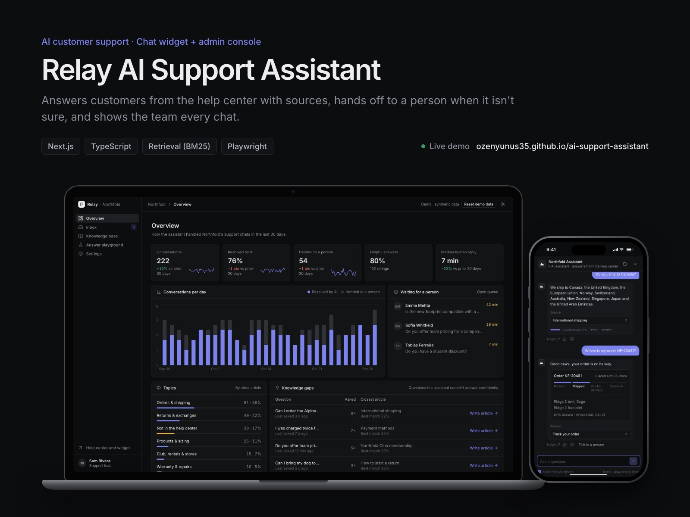
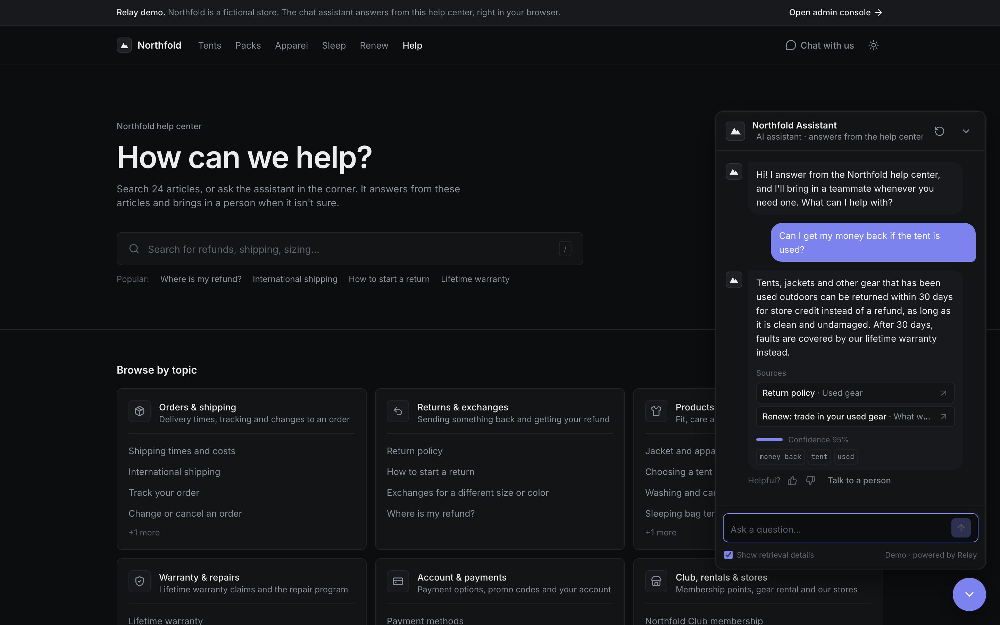
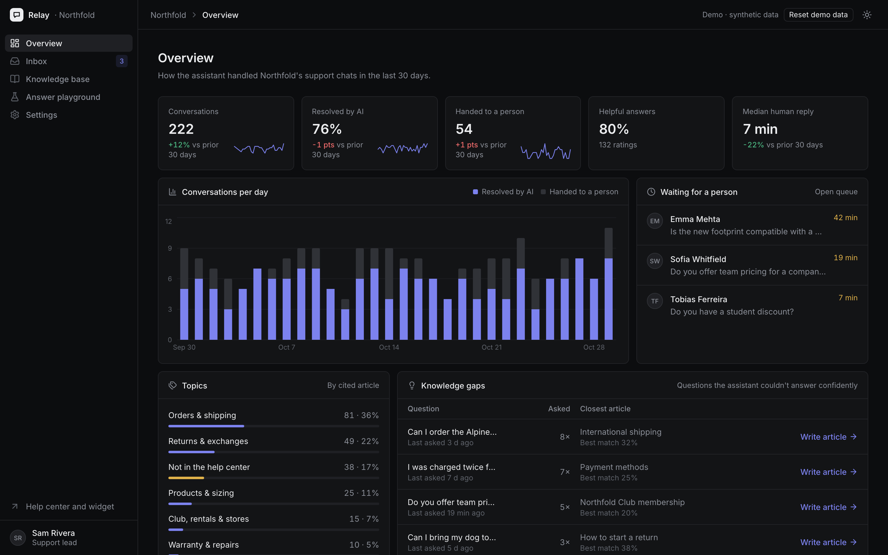
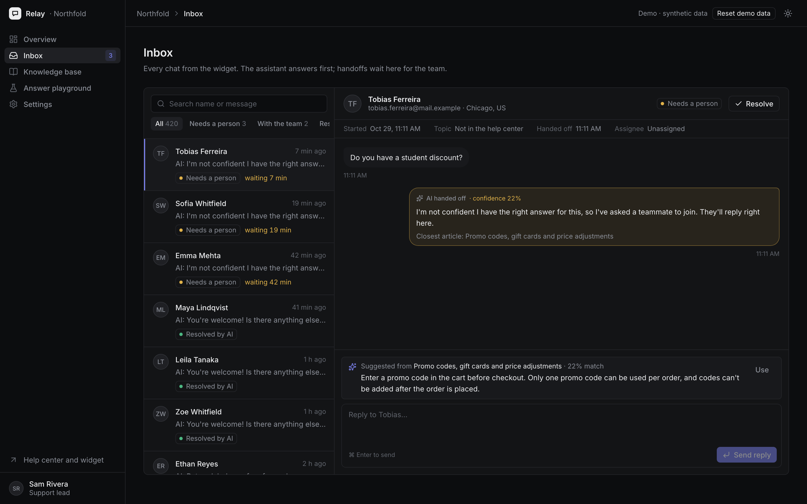
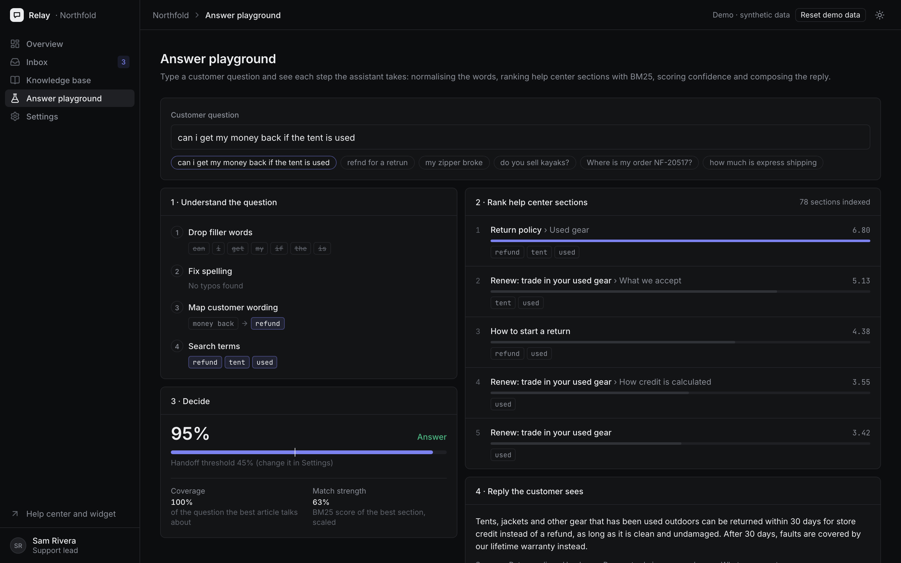
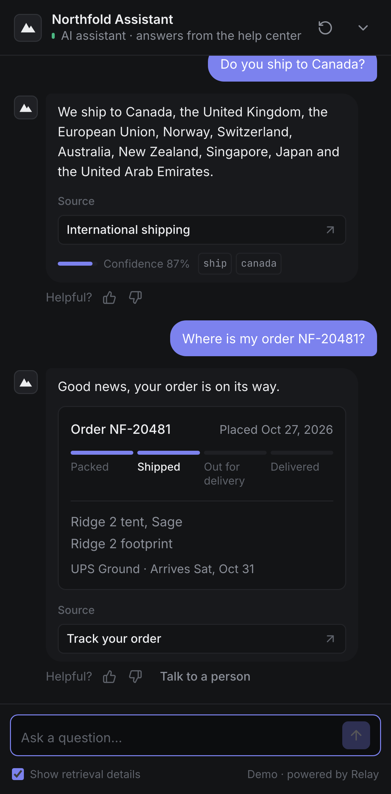

# Relay: AI Customer Support Assistant

A support chat widget for a store's website that answers from the help center, shows where every answer
comes from, and hands the chat to a person when it isn't sure. The admin console shows every conversation, the
handoff queue, the knowledge base and how well the assistant is doing.

**Live demo:** https://ozenyunus35.github.io/ai-support-assistant/



> **This is a demo.** Northfold is a fictional outdoor gear store, and its policies, orders, customers and
> conversations are synthetic (emails use the reserved `.example` domain, phone numbers are 555-01xx). There is
> no server and no API key: answers are produced in your browser, and data is kept in localStorage. Use
> **Reset demo data** in the admin console to start over.

## Try it

1. Open the live demo. The chat widget opens on the Northfold help center (tap the button on a phone).
2. Ask something, for example *"Can I get my money back if the tent is used?"* or *"Where is my order NF-20481?"*
3. Ask something the help center doesn't cover, like *"Do you sell kayaks?"*. The assistant hands the chat to the team.
4. Open the **admin console** in a second tab, find the chat marked **Live** in the inbox and reply. The reply
   appears in the widget straight away.

## Features

**Chat widget**
- Answers built from the best matching help center section, with linked sources that open the article at the cited section.
- Confidence threshold: below it, the chat goes to a person with a clear message and the expected reply time.
- "Talk to a person" at any time, thumbs up/down on every answer, a new-conversation button.
- Order lookup: asks for the order number and shows a status card (packed, shipped, out for delivery, delivered).
- Understands customer wording (synonyms such as *money back* → *refund*) and fixes small typos.
- Optional retrieval details under each answer: confidence and the words that matched.
- Full-screen on phones, keyboard friendly (Enter to send, Esc to close).

**Admin console**
- Overview: conversations, share resolved by AI, handoffs, helpful-answer rate and median human reply time, each
  against the previous 30 days; conversations per day; topics; the live handoff queue.
- Knowledge gaps: questions the assistant couldn't answer confidently, grouped and counted, with a
  "Write article" button that opens the editor pre-filled.
- Inbox: filters (needs a person, with the team, resolved by AI or by the team), search, transcripts with the
  confidence and sources of every AI answer, customer feedback, replies and resolve. Waiting chats come first.
- Agent assist: a suggested reply from the closest article, even when the assistant was too unsure to send it.
- Knowledge base: article editor with live preview, categories, synonym groups. Changes are re-indexed instantly.
- Answer playground: type a question and see every step, from word normalisation and BM25 ranking to the
  confidence score and the reply.
- Settings: greeting, suggested questions, handoff message and a threshold slider that shows how many of the last
  30 days' answers would have gone to a person at that setting.

| Help center + widget | Overview |
| --- | --- |
|  |  |
| **Inbox** | **Answer playground** |
|  |  |

<p align="center"></p>

## How answers are made

Everything is in [`src/lib/engine.ts`](src/lib/engine.ts):

1. **Analyse the question:** split into words, light stemming, typo fixes against the help center vocabulary,
   synonym phrases mapped to the help center's own words, filler words dropped.
2. **Retrieve:** BM25 over article sections (each `##` heading is a section), with title and heading words weighted up.
3. **Score confidence** from two signals: how much of the question the best article covers (words the help center
   never uses count fully against it), and how strongly the best section matches.
4. **Answer or hand off:** above the threshold, the reply is composed from the most relevant sentences of that
   section and cites it; below it, the chat goes to the team.

### In production

The retrieval and handoff logic stay the same; only the last step changes.

| Demo | Production |
| --- | --- |
| Extractive answer from the best section | An LLM (OpenAI or Anthropic API) writes the reply from the top sections only, with the same citations |
| BM25 + synonyms in the browser | The same BM25, or hybrid search with embeddings (pgvector, Pinecone), on the server |
| localStorage state, `storage` events between tabs | A database plus WebSockets or Server-Sent Events for live replies |
| Order lookup from synthetic orders | A call to the store's order API (Shopify, WooCommerce or a custom backend) |
| Install snippet in Settings | A small script that mounts the widget in an iframe on any site |

## Run it locally

```bash
npm install
npm run dev          # http://localhost:3000
npm test             # unit tests (Vitest)
npm run build        # static export in out/
```

End-to-end tests run against the static build, served under `/ai-support-assistant/` like on GitHub Pages:

```bash
npx playwright install chromium webkit
PAGES_BASE_PATH=/ai-support-assistant npm run build
npm run test:e2e     # desktop Chrome, desktop Safari (WebKit), iPhone, Android
BASE_URL=https://ozenyunus35.github.io/ai-support-assistant/ npm run test:e2e   # against the live site
```

## Tests

- **Unit (Vitest):** stemming and sentence splitting, retrieval for real customer phrasings, synonyms, typo fixes,
  handoff below the threshold and on request, order lookup, seed data integrity, analytics.
- **End-to-end (Playwright):** help center search, cited answers and source links, feedback, order lookup,
  handoff and a live reply from the inbox to the widget in a second tab, new articles and synonyms used right away,
  settings, inbox filters, reset, theme, phone layout, and a check that no page scrolls sideways, on four
  browser/device profiles.

GitHub Actions runs lint, type check, unit and e2e tests on every push to `main`, then deploys to GitHub Pages.

## Tech

Next.js 16 (App Router, static export), React 19, TypeScript, Tailwind CSS 4, Recharts, Lucide icons, Vitest,
Playwright. MIT License.
