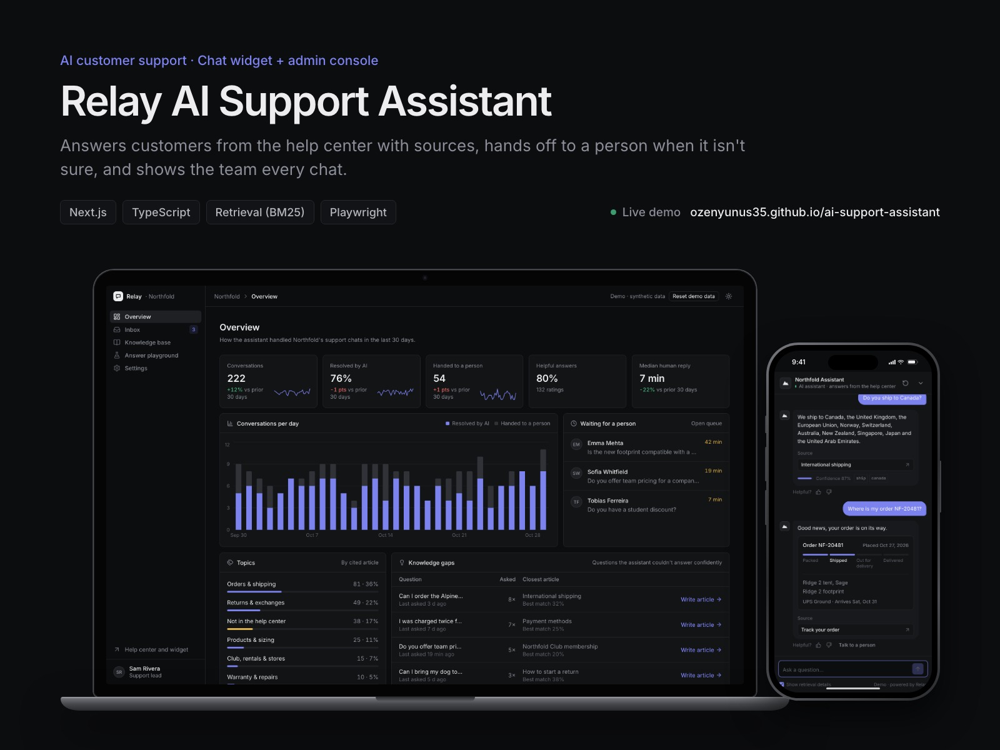
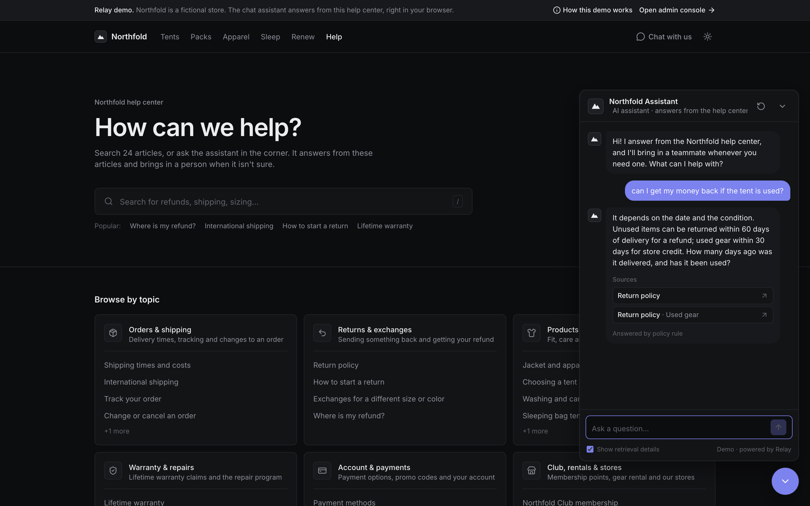
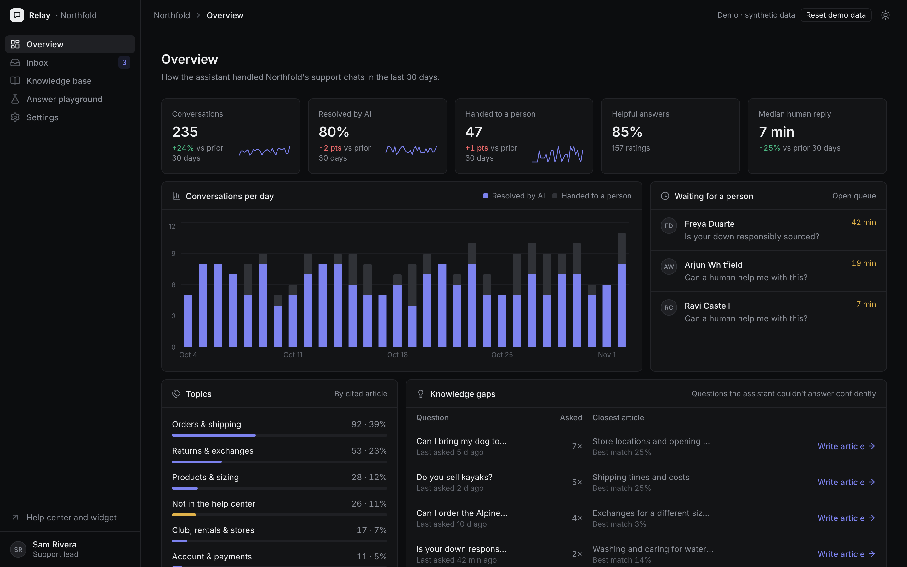
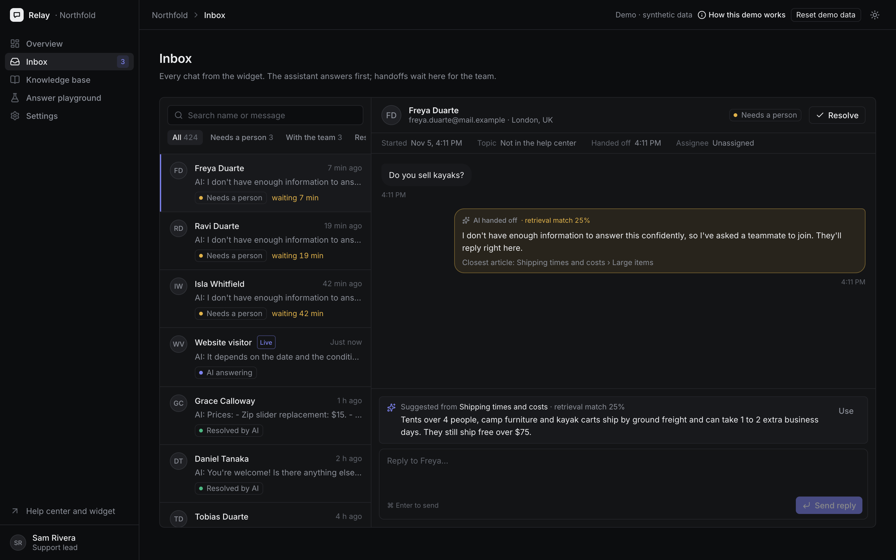
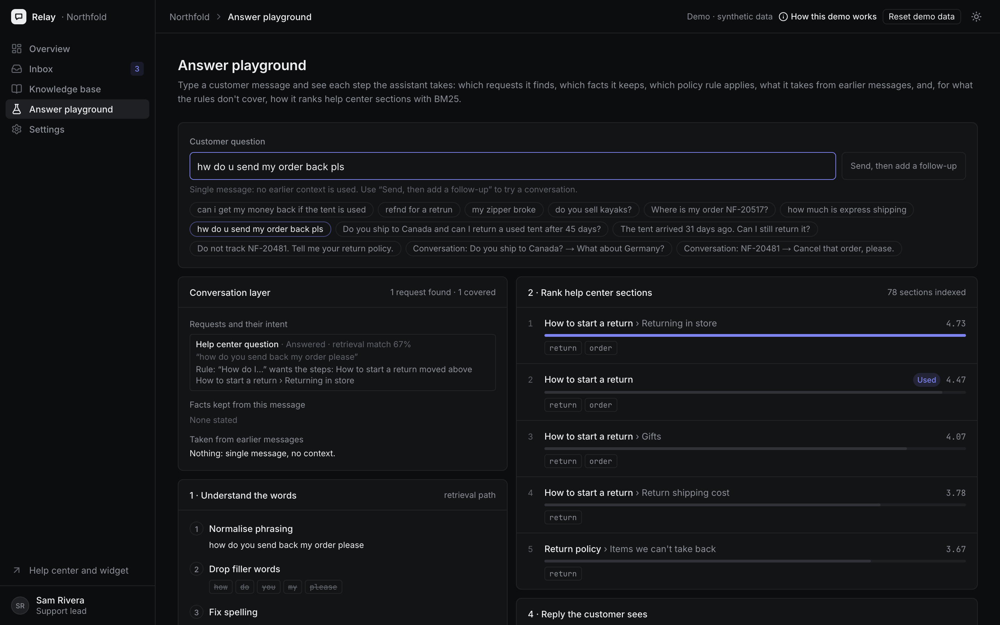
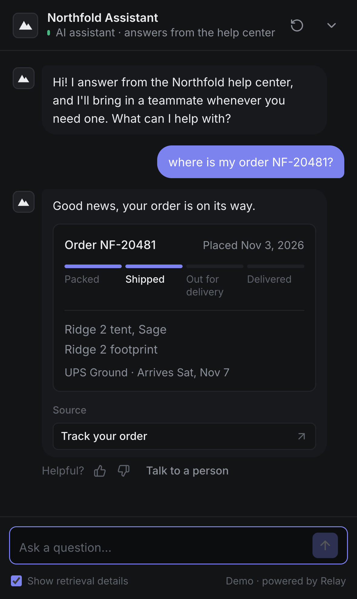

# Relay: AI Customer Support Assistant

A support chat widget for a store's website that answers from the help center, shows where every answer
comes from, and hands the chat to a person when it isn't sure. The admin console shows every conversation, the
handoff queue, the knowledge base and how well the assistant is doing.

**Live demo:** https://ozenyunus35.github.io/ai-support-assistant/



> **This is a demo.** Northfold is a fictional outdoor gear store, and its policies, orders, customers and
> conversations are synthetic (emails use the reserved `.example` domain, phone numbers are 555-01xx). There is
> no server and no API key: answers are produced in your browser, and data is kept in localStorage. Use
> **Reset demo data** in the admin console to start over.

## Try it

1. Open the live demo. The chat widget opens on the Northfold help center (tap the button on a phone). **How this demo works** in the top bar says what is real and what is not, and lists a 90-second route.
2. Ask something, for example *"Can I get my money back if the tent is used?"* or *"Where is my order NF-20481?"*
3. Ask something the help center doesn't cover, like *"Do you sell kayaks?"*. The assistant hands the chat to the team.
4. Open the **admin console** in a second tab, find the chat marked **Live** in the inbox and reply. The reply
   appears in the widget straight away.

## Features

**Chat widget**
- Answers built from the best matching help center section, with linked sources that open the article at the cited section.
- Retrieval-match threshold: when an answer found by searching the help center fits the question less well than the threshold, the chat goes to a person with a clear message and the expected reply time. A customer who asks for a person gets one whatever the threshold, with its own message.
- "Talk to a person" at any time, thumbs up/down on every answer, a new-conversation button. While a chat waits
  for the team, the assistant still answers what it is sure about.
- Order lookup: asks for the order number and shows a status card (packed, shipped, out for delivery, delivered).
- Understands customer wording (synonyms such as *money back* → *refund*) and fixes small typos.
- Remembers the conversation: "What about Germany?" after a shipping question, "Cancel that order" after an order lookup, "It is unused" after a return question. A new conversation starts clean.
- Answers every question in a message ("Do you ship to Canada and can I return a used tent after 45 days?") and keeps the numbers and conditions the customer gave: days, used or unused, amounts, order status.
- Optional retrieval details under each answer: the retrieval match (or "Answered by policy rule"), how many requests were answered, and the words that matched.
- Full-screen on phones, keyboard friendly (Enter to send, Esc to close).

**Admin console**
- Overview: conversations, share resolved by AI, handoffs, helpful-answer rate and median human reply time, each
  against the previous 30 days; conversations per day; topics; the live handoff queue.
- Knowledge gaps: questions the assistant couldn't answer confidently, grouped and counted, with a
  "Write article" button that opens the editor pre-filled.
- Inbox: filters (needs a person, with the team, resolved by AI or by the team), search, transcripts with the
  retrieval match (or the policy rule) and sources of every AI answer, customer feedback, replies and resolve. Waiting chats come first.
- Agent assist: a suggested reply from the closest article, even when the assistant was too unsure to send it.
- Knowledge base: article editor with live preview, categories, synonym groups. Changes are re-indexed instantly.
- Answer playground: type a message and see every step: the requests it found and their intent, the facts it kept (days,
  country, used or unused, order number), phrases the customer said they do not mean, what it took from earlier messages
  (it has a small conversation mode), what is still missing, the policy rule that applied, why it handed off, and for
  the part that searches the help center, shorthand and phrase normalisation, typo fixes, BM25 ranking, the signals behind
  the retrieval match and the reply.
- Settings: greeting, suggested questions, the message shown when the assistant is unsure and a threshold slider that shows how many of the last
  30 days' answers would have gone to a person at that setting.
- English and Turkish console: every page, chart, status and message, with dates and percentages in the matching style. The store's help center and the assistant's replies stay in English, since Northfold is an English-speaking store.
- A ⌘K command palette: jump to any page, open any article for editing or any conversation (it searches what customers wrote), reset the demo, switch theme or language.
- Links to a single conversation (`/admin/inbox/?c=…`) or article (`/admin/knowledge/?a=…`).

| Help center + widget | Overview |
| --- | --- |
|  |  |
| **Inbox** | **Answer playground** |
|  |  |

<p align="center"></p>

## How answers are made

A conversation layer ([`src/lib/dialog.ts`](src/lib/dialog.ts)) sits in front of the retrieval engine
([`src/lib/engine.ts`](src/lib/engine.ts)). The chat widget and the admin playground call the same `respondTo`, so
they cannot disagree.

1. **Facts:** what the customer states is kept as data: order number, country, delivery speed, order amount, days
   (and whether they are business or calendar days and counted from delivery, order or return), used or unused,
   defect, final sale, payment method. "29", "30" and "31" days stay different numbers.
2. **Requests:** the message is split by meaning, not only at "and", and every request gets one intent (shipping, return,
   late refund, cancel, exchange, missing item, delivered but not received, human, order lookup, ...). What the customer
   says they do *not* want ("Do not track NF-20481", "I don't want a refund") is set aside, but its facts are kept.
3. **Context:** facts and the topic from earlier messages of the same conversation fill in what a short follow-up
   leaves out. A new topic drops the old return facts; a new conversation carries nothing.
4. **Policy rules** decide what the facts mean: the 60-day refund and 30-day store-credit windows (day 60 and day 30 are
   included), free shipping only *over* $75 (US) and *over* $150 (international), the 10 business days after which a
   missing refund is reviewed, what can still be done to an order that has shipped. Where something is missing the
   reply asks for exactly that, and where the demo can't act it says so: nothing is cancelled, refunded or promised.
   The numbers are in `POLICY` in `dialog.ts`; a test checks that the help center text still states the same ones.
5. **Retrieval** answers whatever the rules don't cover: BM25 over help center sections (each `##` heading is a
   section), after light stemming, typo fixes against the help center vocabulary, synonym phrases mapped to the help
   center's own words, filler words dropped, and texting shorthand ("hw do u track ur order") normalised.
6. **Reply:** one message with the result for the customer's situation, the reason, the next step and the sources. A
   request the assistant can't answer confidently is handed to a person, and the reply says which one.

**Retrieval match.** For an answer found by search, the engine scores two signals: how much of the question the best
article covers (words the help center never uses count fully against it) and how strongly the best section matches,
with a bonus for a clear winner and a nudge for the customer's intent ("repair", "cancel", "return"). That number is
shown as **Retrieval match**. It says how well a help center section fits the question; it is not the probability that
the answer is right, and answers decided by policy rules don't have one. A reply that mixes both shows the lowest match
of its searched parts. Below the threshold the request goes to a person.

**Two kinds of hand-off.** "I want a human" gets "I'm connecting you with a teammate"; a question the assistant
can't answer gets "I don't have enough information to answer this confidently". The demo makes no promise about a
real team or email: after a hand-off the chat waits in the admin inbox.

### In production

The retrieval and handoff logic stay the same; only the last step changes.

| Demo | Production |
| --- | --- |
| Extractive answer from the best section | An LLM (OpenAI or Anthropic API) writes the reply from the top sections only, with the same citations |
| BM25 + synonyms in the browser | The same BM25, or hybrid search with embeddings (pgvector, Pinecone), on the server |
| localStorage state, `storage` events between tabs | A database plus WebSockets or Server-Sent Events for live replies |
| Order lookup from synthetic orders | A call to the store's order API (Shopify, WooCommerce or a custom backend) |
| Policy numbers mirrored in `POLICY` | Read from the policy source of record, so a policy change can't leave the rules stale |
| Install snippet in Settings | A small script that mounts the widget in an iframe on any site |

Not part of this demo and needed before real customers: authentication and order ownership checks (who may see
which order), roles and tenants for the admin console, a database and real sessions instead of localStorage, an audit
log of what the assistant said and did, error, timeout and retry handling, and, if an LLM writes the reply, grounding
and validation against the cited sections, latency and cost limits.

## Run it locally

```bash
npm install
npm run dev          # http://localhost:3000
npm test             # unit tests (Vitest)
npm run build        # static export in out/
```

Screenshots in `docs/` come from `node scripts/screenshots.mjs` against the same build.

End-to-end tests run against the static build, served under `/ai-support-assistant/` like on GitHub Pages:

```bash
npx playwright install chromium webkit
PAGES_BASE_PATH=/ai-support-assistant npm run build
npm run test:e2e     # desktop Chrome, desktop Safari (WebKit), iPhone, Android
BASE_URL=https://ozenyunus35.github.io/ai-support-assistant/ npm run test:e2e   # against the live site
```

## Tests

- **Unit (Vitest):** stemming and sentence splitting, retrieval for real customer phrasings, synonyms, typo fixes,
  handoff below the threshold and on request, order lookup, seed data integrity, analytics.
- **End-to-end (Playwright):** help center search, cited answers and source links, feedback, order lookup,
  handoff and a live reply from the inbox to the widget in a second tab, new articles and synonyms used right away,
  settings, inbox filters, reset, theme, phone layout, and a check that no page scrolls sideways, on four
  browser/device profiles.

- **Conversation layer:** [`tests/unit/dialog.test.ts`](tests/unit/dialog.test.ts) checks behaviour, not wording: the
  intent, the kept conditions, the policy result, the question asked back, the next step and the source. It covers
  the 29/30/31 and 60/61 day boundaries, $149/$150/$151, business versus calendar days, follow-ups, "Cancel that
  order", negated intents, several requests in one message, no fake refund or cancellation, no live stock, and that
  the policy numbers match the help center. [`dialog-eval.test.ts`](tests/unit/dialog-eval.test.ts) measures it on
  generated conversations (below).
- **Answer quality:** [`tests/unit/quality.test.ts`](tests/unit/quality.test.ts) checks the engine on question sets
  with floors a change can't drop below: two sets it was tuned on, a holdout set it was never tuned on, and
  thousands of random customer questions from a generator with typos, filler and emotional openers.

  | Retrieval engine alone, re-measured 2 Nov 2026 after the help center fix, on questions never used for tuning | First version | Now |
  | --- | --- | --- |
  | Random questions, generator 1 (9,000): right | 44% | 81% |
  | Random questions, generator 1: answered from the wrong article | 7.1% | 0.6% |
  | Random questions, generator 2 with texting shorthand and stories (6,000): right | 51% | 63% |
  | Random questions, generator 2: answered from the wrong article | 7.1% | 3.9% |
  | Second holdout (100 hand-written questions): right | 65% | 68% |
  | Second holdout: answered from the wrong article | 7% | 10% |
  | Off-topic questions answered from an article (3,000 random, seed 99) | 0 | 0 |

  Generator 2 and the second holdout were written before the second round of changes; generator 2's seed 11
  was used to check each change, the other seeds and the holdout only for the final numbers. A first holdout
  showed the first round had overfit its tuning questions (it moved only 57% → 58%), so it was turned into a
  tuning set and the approach changed to general rules.

  [`tests/unit/fixtures/answer-text.json`](tests/unit/fixtures/answer-text.json) also checks that the reply states
  the fact that was asked for (a price, a time limit, a link), not just that it cites the right article:
  33 of 35 now, 26 before.

  The rest are handed to a person, which is the safe failure for a support assistant.

  **Conversation layer, on generated conversations.** Two sets of 1,200 each, built from templates with their own
  phrasings; the expected outcome is computed from the policy numbers written into the generator, not read from
  `dialog.ts`. These say how the layer behaves on these shapes of message, not how it would do with real customers.

  | Set | Messages | Right on every check | Wrong and sure of itself | Needless hand-off |
  | --- | --- | --- | --- | --- |
  | 1, first run | 1,200 | 77% (the check for "Cancel that order" had a bug of its own, counting "nothing has been cancelled" as a cancellation) | not measured separately | not measured separately |
  | 1, after fixing what the first run showed | 1,200 | 100% (a tuning set from here on) | 0 of 887 | 0 of 965 |
  | 2, first run, before any change made because of it | 1,200 | 96.7% | 0 of 620 | 6 of 1,200 (0.5%) |
  | 2, after its two fixes | 1,200 | 99.5% (also a tuning set now) | 0 of 620 | 6 of 1,200 (0.5%) |

  On the first run of set 2: the right source was cited in 97.5% of 244 cases that name one, every request of a
  multi-request message was answered in 93.8% of 128, the question asked back (or not asked) was right in 92.8% of
  360, and the earlier message was used where it had to be in 95.6% of 591. The misses were a clause like "my partner
  bought this for me and" read as a request, and "still sealed" not read as unused; both are fixed. The 6 needless
  hand-offs are help center questions with a story in front ("not sure if this is the right place but do you take
  paypal"), which the retrieval engine, as before, can't match; it hands them to a person.

GitHub Actions runs lint, type check, unit and e2e tests on every push to `main`, then deploys to GitHub Pages.

## Tech

Next.js 16 (App Router, static export), React 19, TypeScript, Tailwind CSS 4, Recharts, Lucide icons, Vitest,
Playwright. MIT License.
